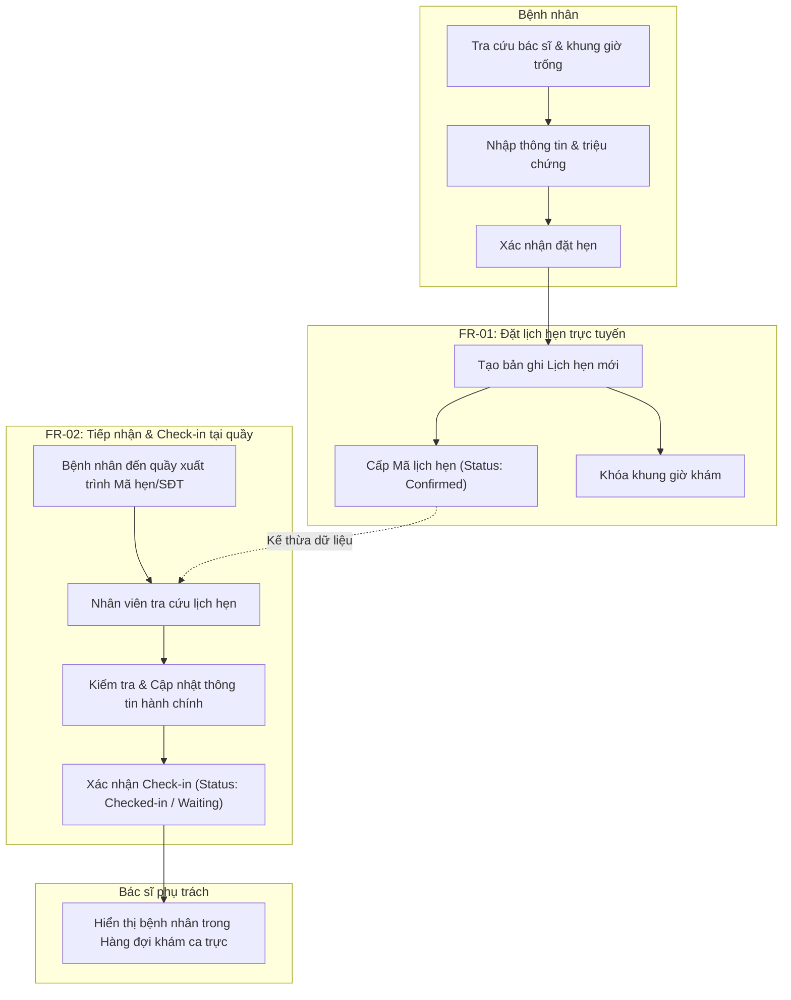

# TÀI LIỆU ĐẶC TẢ YÊU CẦU CHỨC NĂNG
## Dự án: Hệ thống Quản lý Phòng khám Đa khoa An Tâm
**Học phần:** Nhập môn Công nghệ Phần mềm (Intro2SE - BT04)  
**Phiên bản:** 1.0  
**Ngày lập:** 10/11/2026  

---

## 1. Tổng quan & Bối cảnh nghiệp vụ
Phòng khám đa khoa An Tâm là cơ sở y tế quy mô nhỏ gồm:
* **Nhân sự:** 06 bác sĩ thuộc nhiều chuyên khoa, 02 nhân viên tiếp nhận mỗi ca.
* **Lưu lượng:** 80–120 lượt bệnh nhân mỗi ngày.
* **Hiện trạng nghiệp vụ:** Đặt lịch qua điện thoại ghi chép sổ giấy, thông tin dễ thất lạc, khó cập nhật khi có thay đổi lịch bác sĩ hoặc bệnh nhân đổi giờ.

Tài liệu này tập trung đặc tả **02 chức năng cốt lõi có liên kết nghiệp vụ trực tiếp** với nhau:
1. **`FR-01`**: Đặt lịch hẹn khám bệnh trực tuyến (Appointment Booking)
2. **`FR-02`**: Tiếp nhận và Check-in bệnh nhân tại quầy (Patient Check-in & Reception)

---

## 2. Mô hình liên kết giữa 2 chức năng

---

## 3. Đặc tả yêu cầu chức năng (Theo biểu mẫu Section 03)

### 3.1. Đặc tả yêu cầu FR-01

| Thuộc tính | Chi tiết đặc tả |
| :--- | :--- |
| **ID** | **FR-01** |
| **Loại yêu cầu** | Yêu cầu chức năng (Functional Requirement) |
| **Nguồn (Source)** | • Quản lý phòng khám: *“Tôi muốn bệnh nhân đặt lịch nhanh, không phải gọi nhiều lần.”* • Bệnh nhân: *“Tôi muốn đổi lịch mà không phải đến tận nơi.”* • **Quy tắc xác nhận:** Giới hạn mỗi slot 15 phút nhận tối đa 02 bệnh nhân/bác sĩ; Hủy lịch trước tối thiểu 30 phút. |
| **Độ ưu tiên** | **Must Have** |
| **Phiên bản** | **1.1** (Cập nhật quy tắc dung lượng và hủy lịch) |
| **Mô tả** | Trong bối cảnh bệnh nhân có nhu cầu thăm khám, hệ thống phải cho phép bệnh nhân tra cứu lịch làm việc của 06 bác sĩ theo chuyên khoa, hiển thị các khung giờ được chia thành các slot **15 phút**. Mỗi slot 15 phút cho phép **tối đa 02 bệnh nhân** đăng ký cho cùng một bác sĩ. Khi một slot đã có 02 lượt đăng ký, hệ thống tự động khóa slot đó (`Hết chỗ`). Bệnh nhân nhập thông tin cá nhân và gửi yêu cầu đặt hẹn. Hệ thống lưu trữ bản ghi lịch hẹn và gửi Mã lịch hẹn (Appointment Code) kèm hướng dẫn đến số điện thoại/email của bệnh nhân trong vòng 30 giây. Bệnh nhân có quyền hủy/đổi lịch trực tuyến nhưng phải thực hiện **trước giờ khám tối thiểu 30 phút**. |
| **Lý do** | Kiểm soát chặt chẽ dung lượng phục vụ (80–120 lượt/ngày chia đều cho 6 bác sĩ), tránh tình trạng bác sĩ bị quá tải dồn ứ bệnh nhân trong một khung giờ, đồng thời hạn chế tình trạng giữ chỗ ảo. |
| **Tiêu chí kiểm chứng** | 1. Mỗi slot 15 phút chấp nhận tối đa 2 lần đặt thành công cho 1 bác sĩ; lượt thứ 3 vào cùng slot lập tức bị từ chối và báo hết chỗ. 2. Bản ghi mới xuất hiện trong cơ sở dữ liệu với trạng thái `Đã xác nhận (Confirmed)`. 3. Bệnh nhân hủy lịch trước giờ hẹn $\ge$ 30 phút: hệ thống chấp nhận hủy và mở lại slot. 4. Bệnh nhân cố gắng hủy lịch khi còn $< 30$ phút: hệ thống từ chối tự động hủy và hiển thị cảnh báo liên hệ hotline. |

---

### 3.2. Đặc tả yêu cầu FR-02

| Thuộc tính | Chi tiết đặc tả |
| :--- | :--- |
| **ID** | **FR-02** |
| **Loại yêu cầu** | Yêu cầu chức năng (Functional Requirement) |
| **Nguồn (Source)** | • Nhân viên tiếp nhận: *“Lịch thay đổi liên tục; nếu sửa ở sổ thì đôi khi người khác không biết.”* • Bác sĩ: *“Tôi cần biết hôm nay ai đến khám và hồ sơ nào cần chuẩn bị.”* • **Quy tắc xác nhận:** Tự động hủy lịch nếu bệnh nhân không đến và không hủy trước 30 phút; Hỗ trợ tiếp nhận bệnh nhân vãng lai (Walk-in). |
| **Độ ưu tiên** | **Must Have** |
| **Phiên bản** | **1.1** (Bổ sung xử lý vắng mặt No-show và Khám vãng lai) |
| **Mô tả** | Trong bối cảnh bệnh nhân đến phòng khám theo lịch đã hẹn, hệ thống phải cho phép 02 nhân viên tiếp nhận tra cứu lịch theo Mã lịch hẹn hoặc Số điện thoại, kiểm tra và đối chiếu thông tin cá nhân (bổ sung số thẻ CCCD/BHYT nếu là bệnh nhân mới) và thực hiện hành động xác nhận Check-in. Khi hoàn tất, hệ thống tự động cập nhật trạng thái lịch hẹn sang `Đang chờ khám (Waiting)` và đẩy thông tin vào màn hình hàng đợi ca trực của bác sĩ tương ứng theo thời gian thực.  **Quy tắc bổ sung:** 1. *Xử lý vắng mặt (No-show):* Nếu quá 15 phút so với giờ hẹn mà bệnh nhân không có mặt và không thực hiện hủy trước 30 phút, hệ thống tự động đánh dấu lịch là `Đã hủy - Vắng mặt (No-Show)` và giải phóng vị trí. 2. *Khám vãng lai (Walk-in):* Hệ thống cho phép nhân viên tiếp nhận tạo lịch khám nhanh tại chỗ cho bệnh nhân vãng lai nếu slot 15 phút còn chỗ trống ($< 2$ bệnh nhân) hoặc chèn vào slot vừa bị hủy do No-show. |
| **Lý do** | Tránh sai lệch thông tin khi nhiều nhân viên cùng làm việc một ca, đảm bảo dữ liệu đồng bộ tức thời đến bác sĩ, rút ngắn thời gian xếp hàng tại sảnh chờ, tối ưu hóa công suất khám của bác sĩ khi có bệnh nhân bỏ lịch. |
| **Tiêu chí kiểm chứng** | 1. Nhân viên tìm thấy chính xác thông tin lịch hẹn tạo từ FR-01 trong vòng dưới 2 giây. 2. Nhấn nút "Xác nhận tiếp nhận/Check-in" thành công; bác sĩ thấy bệnh nhân trong hàng đợi theo thời gian thực. 3. Quá giờ hẹn 15 phút mà chưa check-in: Trạng thái tự động chuyển thành `No-Show`, slot được giải phóng. 4. Nhân viên tiếp nhận có thể tạo lịch khám vãng lai thành công vào slot còn trống. |

---

## 4. Đặc tả tình huống sử dụng (Scenario Specifications)

### SC-01 · Đặt lịch trực tuyến và Tiếp nhận khám thành công
* **Tác nhân chính:** Bệnh nhân, Nhân viên tiếp nhận, Bác sĩ.
* **Tiền điều kiện:** 
  * Lịch trực của bác sĩ đã được cấu hình trên hệ thống.
  * Thiết bị của bệnh nhân kết nối Internet; Quầy tiếp nhận đăng nhập hệ thống nội bộ.
* **Kích hoạt:** Bệnh nhân truy cập cổng dịch vụ đặt lịch trực tuyến của Phòng khám An Tâm.

#### Luồng sự kiện chính (Main Flow):
1. Bệnh nhân chọn Chuyên khoa $\rightarrow$ chọn Bác sĩ $\rightarrow$ chọn Ngày khám.
2. Hệ thống hiển thị danh sách các khung giờ còn trống trong ngày.
3. Bệnh nhân chọn khung giờ phù hợp, nhập Họ tên, Ngày sinh, Số điện thoại và Mô tả triệu chứng.
4. Bệnh nhân nhấn nút **"Xác nhận đặt lịch"** (*Thực thi FR-01*).
5. Hệ thống khóa khung giờ, lưu thông tin cuộc hẹn với trạng thái `Đã xác nhận`, và gửi Mã lịch hẹn (VD: `AT-20261110-089`) kèm mã QR qua SMS/Email cho bệnh nhân.
6. Vào ngày hẹn, bệnh nhân đến quầy tiếp nhận và cung cấp Mã lịch hẹn (hoặc quét mã QR).
7. Nhân viên tiếp nhận tra cứu lịch hẹn trên phần mềm (*Thực thi FR-02*).
8. Hệ thống hiển thị chi tiết lịch hẹn và hồ sơ đã đặt trước.
9. Nhân viên xác nhận sự có mặt của bệnh nhân, cập nhật giấy tờ tùy thân (nếu thiếu), sau đó nhấn **"Tiếp nhận vào khám"**.
10. Hệ thống đổi trạng thái lịch thành `Đang chờ khám` và đẩy lượt khám vào danh sách chờ của Bác sĩ.
11. Bác sĩ thấy tên bệnh nhân xuất hiện tại buồng khám tương ứng.

#### Luồng thay thế & Ngoại lệ (Alternative & Exception Flows):
* **2a. Không còn khung giờ trống:**
  * Hệ thống thông báo bác sĩ đã kín lịch vào ngày đã chọn và đề xuất ngày gần nhất còn trống hoặc bác sĩ khác cùng chuyên khoa.
* **4a. Trùng lặp thông tin đặt lịch:**
  * Nếu bệnh nhân đang có một lịch hẹn chưa khám cùng chuyên khoa trong ngày, hệ thống cảnh báo và yêu cầu xác nhận thay đổi thay vì tạo thêm lịch mới.
* **7a. Bệnh nhân quên/làm mất mã lịch hẹn:**
  * Nhân viên tìm kiếm theo Số điện thoại và Họ tên. Hệ thống hiển thị danh sách trùng khớp để đối chiếu ngày sinh.
* **9a. Bệnh nhân đến trễ quá 15 phút so với khung giờ hẹn:**
  * Hệ thống hiển thị cảnh báo `Đến trễ`.
  * Nhân viên có 2 tùy chọn theo quy chế phòng khám: Chuyển bệnh nhân sang chế độ *Chờ xen kẽ* hoặc dời sang khung giờ trống kế tiếp trong ca trực.

* **Hậu điều kiện:** Bệnh nhân có tên trong hàng đợi của Bác sĩ; trạng thái lịch hẹn chuyển thành `Đang chờ khám (Waiting)`.

---

### SC-02 · Khung giờ hoặc Bác sĩ không còn khả dụng
* **Tác nhân chính:** Bệnh nhân.
* **Tiền điều kiện:** Bệnh nhân đang truy cập màn hình đặt lịch.
* **Kích hoạt:** Bệnh nhân chọn một khung giờ và nhấn "Xác nhận đặt lịch".

#### Luồng sự kiện chính:
1. Bệnh nhân chọn chuyên khoa, bác sĩ và chọn khung giờ $T$.
2. Bệnh nhân nhập thông tin cá nhân và bấm gửi yêu cầu.
3. Hệ thống kiểm tra đồng thời (Concurrency check) trạng thái slot $T$ trong CSDL.
4. Hệ thống phát hiện slot $T$ vừa bị người dùng khác đặt trước (hoặc bác sĩ vừa khóa lịch đột xuất).
5. Hệ thống hiển thị thông báo lỗi thân thiện: *"Rất tiếc, khung giờ này vừa được đăng ký. Vui lòng chọn khung giờ khác!"*.
6. Hệ thống tự động làm mới danh sách khung giờ trống trong ngày đó của bác sĩ, đồng thời gợi ý thêm:
   * Các khung giờ trống liền kề trong cùng buổi.
   * Danh sách bác sĩ khác cùng chuyên khoa còn slot trống trong ngày.
7. Bệnh nhân chọn khung giờ mới được gợi ý và tiếp tục luồng đặt lịch thông thường.

* **Hậu điều kiện:** Slot $T$ hiển thị trạng thái `Đã kín`; không phát sinh bản ghi trùng lịch; bệnh nhân không bị mất các thông tin cá nhân đã điền ở form trước đó.

---

### SC-03 · Bệnh nhân đổi hoặc hủy lịch hẹn
* **Tác nhân chính:** Bệnh nhân (hoặc Nhân viên tiếp nhận thao tác thay).
* **Tiền điều kiện:** Lịch hẹn đã tồn tại ở trạng thái `Đã xác nhận (Confirmed)`.
* **Kích hoạt:** Bệnh nhân nhập Mã lịch hẹn và Số điện thoại vào trang "Tra cứu / Quản lý lịch hẹn".

#### Luồng sự kiện chính:
1. Bệnh nhân tra cứu lịch hẹn bằng Mã lịch hẹn + OTP gửi về số điện thoại.
2. Hệ thống hiển thị thông tin chi tiết lịch khám hiện tại.
3. Bệnh nhân chọn tác vụ **"Đổi lịch hẹn"** hoặc **"Hủy lịch hẹn"**.
4. **Trường hợp A - Đổi lịch:**
   * Bệnh nhân chọn ngày khám và khung giờ mới còn trống.
   * Hệ thống kiểm tra quy tắc nghiệp vụ: *Thời điểm đổi lịch phải cách giờ khám cũ tối thiểu **30 phút***.
   * Hệ thống cập nhật thời gian khám mới, giải phóng (unlock) khung giờ cũ cho bệnh nhân khác đăng ký.
   * Hệ thống gửi thông báo xác nhận đổi lịch thành công.
5. **Trường hợp B - Hủy lịch:**
   * Bệnh nhân chọn lý do hủy (tùy chọn) và nhấn xác nhận hủy trước giờ khám $\ge$ **30 phút**.
   * Hệ thống cập nhật trạng thái lịch sang `Đã hủy (Cancelled)` và giải phóng khung giờ ngay lập tức.
   * Hệ thống gửi tin nhắn thông báo xác nhận hủy lịch đến bệnh nhân.

#### Luồng ngoại lệ & Xử lý vắng mặt (No-Show):
* **3a. Bệnh nhân yêu cầu đổi/hủy sát giờ khám (< 30 phút):**
  * Hệ thống từ chối tự động đổi/hủy trên web và hiển thị thông báo: *"Đã quá thời hạn đổi/hủy trực tuyến (trước 30 phút). Vui lòng liên hệ trực tiếp số hotline phòng khám để được hỗ trợ."*
* **3b. Bệnh nhân không đến và không hủy trước 30 phút:**
  * Sau khi khung giờ hẹn trôi qua 15 phút mà bệnh nhân không check-in tại quầy, hệ thống tự động kích hoạt tiến trình nền chuyển trạng thái lịch hẹn thành `Đã hủy - Vắng mặt (No-Show)`.
  * Khung giờ hoặc thứ tự khám đó được giải phóng để nhân viên quầy tiếp nhận ưu tiên phục vụ bệnh nhân vãng lai (Walk-in).

---

### SC-04 · Bác sĩ nghỉ đột xuất và điều phối lại danh sách khám
* **Tác nhân chính:** Quản lý phòng khám, Nhân viên tiếp nhận, Hệ thống tự động.
* **Tiền điều kiện:** Có danh sách các lịch hẹn đã được đặt trước cho Bác sĩ X trong ca trực bị hủy.
* **Kích hoạt:** Quản lý cập nhật trạng thái ca trực của Bác sĩ X thành `Nghỉ đột xuất`.

#### Luồng sự kiện chính:
1. Quản lý nhập lý do và xác nhận hủy ca trực của Bác sĩ X.
2. Hệ thống tự động quét toàn bộ các lịch hẹn bị ảnh hưởng trong ca trực đó.
3. Hệ thống tự động gửi thông báo khẩn qua SMS/Zalo/Email kèm cuộc gọi tự động (hoặc tạo danh sách việc cần gọi cho nhân viên tiếp nhận) với nội dung: thông báo sự cố và gửi liên kết ưu tiên đổi lịch/bác sĩ thay thế.
4. Màn hình của Nhân viên tiếp nhận hiển thị bảng phân luồng khẩn cấp:
   * Tùy chọn 1: Chuyển bệnh nhân sang bác sĩ khác cùng chuyên khoa còn khả dụng.
   * Tùy chọn 2: Ưu tiên bảo lưu và xếp lịch khám bù sớm nhất theo yêu cầu bệnh nhân.
5. Khi bệnh nhân phản hồi xác nhận, hệ thống tự động cập nhật lại lịch hẹn mới và giải phóng các cảnh báo.

* **Hậu điều kiện:** Toàn bộ bệnh nhân trong ca của bác sĩ nghỉ đều được thông báo và xử lý điều phối; không xảy ra tình trạng bệnh nhân đến nơi mới biết bác sĩ vắng mặt.

---

## 5. Ma trận truy vết (Traceability Matrix)

| Nhu cầu nghiệp vụ | Stakeholder | Requirement ID | Scenario | Test Case ID | Ghi chú CR-01 |
| :--- | :--- | :--- | :--- | :--- | :--- |
| Đặt lịch hẹn nhanh, không cần gọi điện thoại | Quản lý, Bệnh nhân | **FR-01** | SC-01, SC-02 | TC-BOOK-01, TC-BOOK-02 | Chịu tác động bởi CR-01 (bổ sung thanh toán trước) |
| Cập nhật danh sách bệnh nhân và phân luồng tức thì | Bác sĩ, Nhân viên tiếp nhận | **FR-02** | SC-01 | TC-RECP-01, TC-RECP-02 | Chịu tác động bởi CR-01 (check-in phòng khám ảo) |
| Đổi / Hủy lịch linh hoạt không cần đến trực tiếp | Bệnh nhân | **FR-01**, **FR-02** | SC-03 | TC-RESCHED-01 | Ảnh hưởng chính sách hoàn tiền trong CR-01 |
| Ứng phó sự cố bác sĩ vắng mặt đột xuất | Quản lý, Bác sĩ, Nhân viên | **FR-01**, **FR-02** | SC-04 | TC-EMERG-01 | Kích hoạt quy trình hoàn tiền tự động của CR-01 |

---

## 6. Phân tích tác động của yêu cầu thay đổi (Change Request · CR-01)
> **CR-01 · Khám trực tuyến:** Phòng khám cung cấp dịch vụ khám bệnh trực tuyến. Bệnh nhân phải thanh toán trước để xác nhận lịch; nếu bác sĩ hủy lịch, hệ thống hoàn tiền và thông báo cho bệnh nhân.

| Yêu cầu bị ảnh hưởng | Nội dung thay đổi / Tác động | Rủi ro / Điểm cần khảo sát mới |
| :--- | :--- | :--- |
| **FR-01 (Đặt lịch hẹn)** | • Bổ sung bước tích hợp cổng thanh toán trực tuyến (VNPay/MoMo/Chuyển khoản QR). • Trạng thái lịch hẹn có thêm: `Chờ thanh toán (Pending Payment)` $\rightarrow$ `Đã thanh toán (Paid)`. • Áp dụng cơ chế Time-out: Khung giờ chỉ giữ tạm trong 10 phút, nếu chưa thanh toán sẽ tự động hủy. | • Tỷ lệ treo slot do lỗi giao dịch ngân hàng. • Quy trình hoàn tiền (Refund workflow) thủ công hay tự động? Mất bao lâu tiền về tài khoản bệnh nhân? |
| **FR-02 (Tiếp nhận & Check-in)** | • Thay vì tiếp nhận tại quầy vật lý, chuyển sang cơ chế **Check-in phòng chờ ảo (Virtual Waiting Room)**. • Hệ thống tự động kiểm tra trạng thái thanh toán trước khi mở liên kết cuộc gọi video (Telehealth Video Link) 10 phút trước giờ khám. | • Xử lý sự cố mạng, bệnh nhân không kết nối được camera/micro. • Bác sĩ trễ giờ gọi video thì cơ chế gia hạn khung giờ như thế nào? |

---

## 7. Kịch bản kiểm thử (Test Scenarios - Đầu ra 06)

| Test Case ID | Requirement ID | Mục tiêu kiểm thử | Các bước thực hiện | Kết quả mong đợi (Pass Criteria) |
| :--- | :--- | :--- | :--- | :--- |
| **TC-BOOK-01** | FR-01 | Đặt lịch thành công với khung giờ hợp lệ | 1. Chọn Bác sĩ A, ngày $D$, khung giờ 08:30. 2. Nhập thông tin bệnh nhân hợp lệ. 3. Bấm "Xác nhận đặt lịch". | • Hệ thống tạo lịch hẹn mới trạng thái `Confirmed`. • Gửi SMS chứa mã hẹn trong 15s. • Khung giờ 08:30 không còn chọn được nữa. |
| **TC-BOOK-02** | FR-01 | Xử lý xung đột khi 2 người cùng đặt 1 slot | 1. User 1 và User 2 cùng mở slot 09:00. 2. User 1 bấm xác nhận trước 1 giây. 3. User 2 bấm xác nhận ngay sau đó. | • User 1 đặt lịch thành công. • User 2 nhận thông báo lỗi slot đã kín và được gợi ý slot khác, không bị lỗi 500. |
| **TC-RECP-01** | FR-02 | Check-in đúng hẹn tại quầy tiếp nhận | 1. Nhân viên nhập Mã lịch hẹn của TC-BOOK-01. 2. Nhấn nút "Tiếp nhận vào khám". | • Trạng thái lịch đổi sang `Waiting`. • Bệnh nhân xuất hiện tức thì trong danh sách chờ của Bác sĩ A (< 2 giây). |
| **TC-RECP-02** | FR-02 | Cảnh báo bệnh nhân đến trễ > 15 phút | 1. Lịch hẹn lúc 08:00. 2. Nhân viên tra cứu mã lúc 08:20. 3. Quan sát phản hồi của hệ thống. | • Hệ thống hiển thị badge màu đỏ `Đến trễ (Late)`. • Hiển thị hộp thoại gợi ý xếp lại lượt khám. |

---

## 8. Quy tắc nghiệp vụ đã xác thực & Câu hỏi còn tồn đọng

### 8.1. Các quy tắc nghiệp vụ đã được xác nhận (Confirmed Business Rules)
Dựa trên kết quả phản hồi từ Stakeholder phòng khám An Tâm, 03 quy tắc cốt lõi đã được xác lập chính thức:
1. **Dung lượng tiếp nhận:** Mỗi khung giờ khám có thời lượng **15 phút**, tiếp nhận **tối đa 02 bệnh nhân** cho một bác sĩ.
2. **Quy định hủy lịch & Xử lý vắng mặt (No-Show):** 
   * Bệnh nhân muốn hủy hoặc dời lịch phải thực hiện trước giờ khám tối thiểu **30 phút**.
   * Nếu bệnh nhân không đến khám và không báo hủy trước 30 phút, lịch hẹn sẽ **tự động bị hủy bỏ (đánh dấu No-Show)** sau khi quá giờ hẹn 15 phút.
3. **Chính sách tiếp nhận bệnh nhân vãng lai (Walk-in):** **CÓ**. Phòng khám vẫn tiếp nhận bệnh nhân đến trực tiếp không hẹn trước bằng cách xếp vào các slot 15 phút chưa đủ 2 người hoặc tận dụng các slot vừa bị hủy do bệnh nhân No-Show.

### 8.2. Câu hỏi kỹ thuật cần làm rõ thêm (Technical Issues)
1. **Quyền riêng tư hồ sơ:** Bác sĩ có được xem chéo lịch khám và hồ sơ bệnh án của bệnh nhân thuộc bác sĩ khác không (hỗ trợ hội chẩn)? *(Đề xuất mặc định: Cho phép xem tóm tắt tiền sử bệnh để phối hợp liên chuyên khoa)*.
2. **Cơ chế dự phòng khi mất kết nối mạng:** Phòng khám vận hành tiếp nhận thế nào nếu mạng nội bộ hoặc Internet gián đoạn trong ca trực? *(Đề xuất: Chế độ lưu đệm cục bộ Offline Mode tại máy lễ tân)*.

